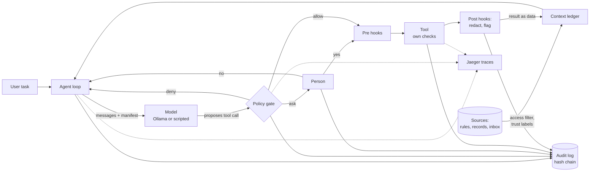

# LLM-Harnass

A local harness for teaching purposes only. Fully configurable.

**In one sentence:** if you download an open-weight language model and let it use tools, whatever it writes can become an action on your systems. This repository shows, in small readable pieces of code, how a harness around the model stops that.

The model can only **propose** actions. The harness **decides**, **limits** and **records**. Every control can be switched on and off in YAML, so you can watch what goes wrong without it.


*Without a harness, model output goes straight to the shell, files, network and email, including actions planted by hidden instructions in untrusted text. With a harness, the model only proposes. A policy gate decides, a person approves risky steps, tools run in a sandbox, and every step goes to an append-only log.*

The repository accompanies the report **Open-Weight LLM Risk Review** ([PDF](docs/report/open-weight-llm-risk-review.pdf), [HTML source](docs/report/open-weight-llm-risk-review.html)). The report lists 26 risks; [the table below](#which-risks-this-repository-covers) shows which ones this code handles and where. Risk numbers in the code comments (for example "risk 7") refer to that table.

> Not for production. The goal is to make the ideas visible, not to be complete. See [What this harness does not do](#what-this-harness-does-not-do).

## Which risks this repository covers

**Built** means the control is in the code and a lesson or test shows it working. **Partly** means part of the control is built and the gap is named. **Not built** means the report describes the control but this repository does not implement it, usually because it is an organisational measure or out of scope for a teaching harness.

| # | Risk | What goes wrong without a harness | What this repository does | Status | Where |
|---|---|---|---|---|---|
| | **Governance and control** | | | | |
| 1 | Governance | No policy on what the model may do, no approval flow. | Deny, ask and allow rules in a YAML file under version control. Anything not listed is denied. `policy-check` dry-runs a call. | Built | `config/policy.yaml`, `harness/policy/gate.py`, lesson 2 |
| 2 | Destructive actions | Deleted or overwritten files, sent emails. | Delete commands are denied. Writes need a person's approval. Every write is snapshotted first and `revert` undoes a session. | Built | `harness/tools/files.py`, lesson 3 |
| 3 | Lack of observability | Nobody can tell what the model did, or why. | A trace per session with a span for every model call, policy check and tool call, viewable in Jaeger. Hooks run before and after every tool call. No alerting. | Built | `harness/telemetry.py`, `harness/hooks/`, lesson 5 |
| 4 | Provenance of actions | No proof of which model, prompt or person led to a change. | Hash-chained audit log in a folder the tools cannot reach. Each event has a session ID; approvals record who approved. The log is tamper-evident, not stored off the machine. | Built | `harness/audit/log.py`, `make verify`, lesson 5 |
| 5 | Excess privilege | The agent runs with every right of the person who started it. | Non-root container, read-only root filesystem, all Linux capabilities dropped. Tools can only touch `workspace/`. | Built | `docker-compose.yml`, `harness/tools/base.py` |
| | **Security** | | | | |
| 6 | Prompt injection | Text in an email or document becomes a command. | Tool output is wrapped and labelled as data. A hook flags instruction-like text. Actions that leave the system need approval. Injection is contained, not prevented. | Built | `harness/context/ledger.py`, `harness/hooks/builtin.py`, lesson 4 |
| 7 | Data exfiltration | The model sends data out through a request or an email. | The harness has no internet route (internal Docker network). Web fetches and email need approval and an allow-listed domain; the list is empty by default. | Built | `docker-compose.yml`, `harness/tools/network.py`, lesson 4 |
| 8 | Secrets exposure | The model reads a key and repeats it. | A deny rule on secret files and a hook that redacts secrets from tool output. Lesson 2 shows a path the deny rule misses and the redactor catches. No secrets vault. | Partly | `config/policy.yaml`, `harness/hooks/builtin.py`, lesson 2 |
| 9 | Supply chain | A model file runs code when it is loaded. | Ollama loads GGUF files, which do not contain code. Container images and Python packages are pinned. The model file's digest is not checked automatically. | Partly | `docker-compose.yml`, `pyproject.toml`, lesson 8 |
| 10 | Memory poisoning | Injected text is saved and reloaded in later sessions. | There is no persistent memory, and the system prompt is mounted read-only, so the model cannot change its own instructions. | Built (by design) | `docker-compose.yml`, `config/system_prompt.md` |
| | **Model integrity** | | | | |
| 11 | Model provenance | Unknown origin, a modified re-upload. | The model name is stored with every model call. Lesson 8 shows how to check and pin a model digest by hand. | Partly | lesson 8 |
| 12 | Hidden behaviour and backdoors | Trigger behaviour that safety training does not remove. | Cannot be fixed in the model. The same gate, sandbox and approvals contain it, and lesson 8 red-teams a real model. | Partly | lesson 8 |
| 13 | False completion | The model reports success without evidence. | The citation check flags sources the model invented. There is no general "prove it worked" step. | Partly | `harness/context/citations.py`, lesson 6 |
| | **Operations** | | | | |
| 14 | Runaway loops and cost | Endless loops, uncontrolled compute. | Limits on steps, wall-clock time and output size. | Built | `config/harness.yaml`, `harness/loop.py`, lesson 7 |
| 15 | Agents interfering | Parallel agents overwrite each other's work. | Out of scope: the harness runs one agent. | Not built | |
| 16 | Reproducibility | No pinned versions. | Pinned images and packages, temperature 0, and a fingerprint of the settings and policy in every session's log. The model is pinned by tag, not digest. | Partly | `docker-compose.yml`, `harness/loop.py` |
| | **Data, context and decisions** | | | | |
| 17 | No record of what the model saw | After a bad decision the input cannot be reconstructed. | The full prompt of every model call is stored with a manifest of its sources. `show-call` prints it. | Built | `harness/audit/log.py`, lesson 6 |
| 18 | Lossy or rewritten context | Truncation or summaries change facts unnoticed. | Truncated output is marked, and the original length and hash are logged. The harness does not summarise. | Partly | `harness/dispatch.py` |
| 19 | Untraceable sources | A data point has no ID, version or time. | Every context item carries a source ID, trust level, version, sha256 and retrieval time. | Built | `harness/context/ledger.py`, lesson 6 |
| 20 | Mixed trust levels | Rules, requests, records and web text look the same. | Four trust levels (owner, user, verified, untrusted). Untrusted text is wrapped as data. | Built | `config/sources.yaml`, `harness/context/ledger.py`, lesson 6 |
| 21 | Stale data | A record changes after it was retrieved. | Versions are recorded, but not re-checked when the model decides. | Not built | |
| 22 | Access leakage through retrieval | Search returns records the user may not see. | Records are filtered by the user's role before they enter the context, and withheld records are logged. | Built | `harness/context/sources.py`, lesson 6 |
| 23 | Personal data in logs | Full logging creates a new store of personal data. | Discussed in lesson 5. No retention limit or minimisation is built. | Not built | lesson 5 |
| 24 | Unfaithful explanations | Citations do not reflect what drove the output. | Citations are checked in code against the sources the model actually received. No remove-a-source-and-rerun test. | Partly | `harness/context/citations.py`, lesson 6 |
| 25 | Decisions that cannot be replayed | A decision cannot be re-run to check it. | The stored prompt, temperature 0 and the settings fingerprint make a manual replay possible. There is no replay command. | Partly | `harness/audit/log.py` |
| | **Compliance** | | | | |
| 26 | Regulatory and contractual | Personal data in prompts, the EU AI Act, model licences. | Organisational, not code. See [Model licences](#model-licences). | Not built | report section 8 |

## What the controls look like

**The governed loop.** The policy check is the only path from a proposal to an action. Results come back marked as data, and every step is written to a log the model cannot change. In code: `harness/loop.py` and `harness/dispatch.py`.


**Context provenance.** Every source enters with a trust level. The harness filters by the user's rights, records a manifest of exactly what went into each model call and stores the full prompt. Citations in the answer are checked against that manifest. In code: `harness/context/`. The human review box is not built here.


**Hosted versus local.** This repository runs the model locally. Local weights cannot send data out on their own; data leaves only through tools and network paths the harness allows. The loader that reads the model file is a separate risk (9 in the table).


The diagrams are exported from the report with `make diagrams`, so the report stays their single source.

## Quick start

You need Docker with Compose. Nothing else runs on your machine.

```bash
make build        # build the harness image
make test         # 34 tests, no model needed
make lint         # flake8, including Google-style docstrings
make up           # start Ollama + Jaeger, download qwen2.5:3b (about 2 GB)
make demo-hello   # lesson 1 with a scripted model
```

Then work through the lessons in [`docs/lessons/`](docs/lessons/).

To give the real model a task:

```bash
make run TASK="Read the latest email in the inbox and summarise it."
```

On a laptop CPU, a real run takes a few minutes. Traces appear at http://localhost:16686 (service `llm-harness`).

## How it fits together



More detail: [`docs/architecture.md`](docs/architecture.md).

## Repository map

| Path | What it is |
|---|---|
| `docker-compose.yml` | Ollama, Jaeger and the harness. The harness sits on an internal network with no internet. |
| `Dockerfile` | Harness image: non-root user, read-only root filesystem at runtime. |
| `config/harness.yaml` | Every setting and on/off switch: model, limits, approval, egress, tools, hooks, tracing. |
| `config/policy.yaml` | The policy gate's rules: deny, ask, allow, and the default. |
| `config/sources.yaml` | Context sources and their trust levels. |
| `config/system_prompt.md` | The owner's rules for the model. |
| `harness/loop.py` | The agent loop. Start reading here. |
| `harness/dispatch.py` | One tool call through every control, in order. |
| `harness/policy/` | Policy gate and human approval. |
| `harness/tools/` | The only way the model can act. Each tool checks its own arguments too. |
| `harness/context/` | Provenance: context items, manifests, access filter, citation check. |
| `harness/hooks/` | Checks before and after each tool call (secret redaction, injection flags). |
| `harness/audit/` | Tamper-evident audit log. |
| `harness/telemetry.py` | OpenTelemetry tracing to Jaeger. |
| `harness/model/` | Ollama client and a scripted fake model for repeatable lessons. |
| `scenarios/` | Scripted model behaviour for the lessons, including a hijacked model. |
| `data/` | Sample records (with access roles) and an inbox with a hidden injection. |
| `workspace/` | The only folder the agent's tools can touch. |
| `var/` | Created at runtime: `audit/` (log, prompts, snapshots) and `outbox/`. Not in git. |
| `tests/` | Unit tests and scenario tests. |
| `.flake8` | Lint rules: flake8 with Google-style docstrings (`make lint`). |
| `scripts/export_diagrams.py` | Exports the report's figures to `docs/diagrams/` (`make diagrams`). |
| `docs/` | Architecture, lessons, the report (PDF and HTML) and the exported diagrams. |

## Lessons

| # | Lesson | Report risks |
|---|---|---|
| 1 | [The loop: the model proposes, the harness decides](docs/lessons/01-the-loop.md) | 1, 3 |
| 2 | [The policy gate and failing closed](docs/lessons/02-policy-gate.md) | 1, 5, 8 |
| 3 | [Destructive actions: approval and undo](docs/lessons/03-destructive-actions.md) | 2 |
| 4 | [Prompt injection and egress](docs/lessons/04-prompt-injection-and-egress.md) | 6, 7, 22 |
| 5 | [Observability and a tamper-evident audit log](docs/lessons/05-observability-and-audit.md) | 3, 4 |
| 6 | [Context provenance: what the model saw and used](docs/lessons/06-context-provenance.md) | 17-25 |
| 7 | [Limits and runaway loops](docs/lessons/07-limits.md) | 14 |
| 8 | [A real open-weight model and red-teaming](docs/lessons/08-real-model-and-red-teaming.md) | 6, 11, 12, 13 |

## Useful commands

```bash
make help                                              # all targets
make verify                                            # check the audit hash chain
make policy-check TOOL=run_command ARGS='{"argv":["rm","-rf","x"]}'
docker compose run --rm harness show-call <call_id>    # what the model saw in one call
docker compose run --rm harness revert <session_id>    # undo a session's file writes
```

## Code style

Every module, class and function has a docstring in [Google style](https://google.github.io/styleguide/pyguide.html#38-comments-and-docstrings) (`Args:`, `Returns:`, `Raises:`). `make lint` runs flake8 with the flake8-docstrings plugin and fails on missing or malformed docstrings in public code. `make check` runs lint and then the tests.

## What this harness does not do

- **No real sandbox beyond Docker.** Containers share the host kernel. For untrusted code, use a VM or gVisor-style isolation.
- **Prompt injection is contained, not solved.** Labels and flags help; the real defence is that a hijacked model cannot do anything dangerous.
- **The audit log is tamper-evident, not tamper-proof.** Ship the chain head to a separate system in real use.
- **No secret manager, no SSO, no multi-tenant isolation.**
- **The model file is not verified.** Lesson 8 shows how to check a model's digest; there is no automatic check.

## Model licences

Any model you download comes with its own licence, separate from this code. Read it before use.
