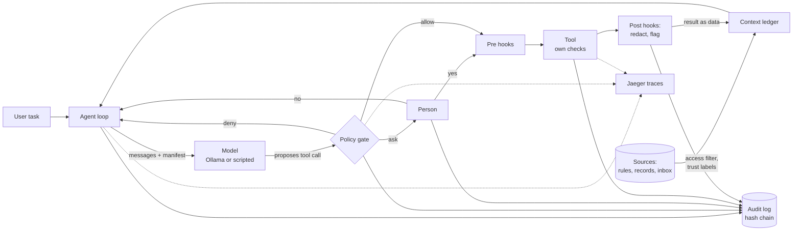

# LLM-Harnass

A local harness for teaching purposes only. Fully configurable.

This repository shows, in small readable pieces of code, how a harness around a language model reduces the risks of running an LLM agent. The model can only **propose** actions. The harness **decides**, **limits** and **records**. Every control can be switched on and off in YAML, so you can watch what goes wrong without it.

It accompanies the report *Open-Weight LLM Risk Review* in [`docs/report/`](docs/report/). Risk numbers in the code comments (for example "risk 7") refer to that report's risk register.

> Not for production. The goal is to make the ideas visible, not to be complete. See [What this harness does not do](#what-this-harness-does-not-do).

## Quick start

You need Docker with Compose. Nothing else runs on your machine.

```bash
make build        # build the harness image
make test         # 34 tests, no model needed
make lint         # flake8, including Google-style docstrings
make up           # start Ollama + Jaeger, download qwen2.5:3b (about 2 GB)
make demo-hello   # lesson 1 with a scripted model
```

Then work through the lessons in [`docs/lessons/`](docs/lessons/).

To give the real model a task:

```bash
make run TASK="Read the latest email in the inbox and summarise it."
```

On a laptop CPU, a real run takes a few minutes. Traces appear at http://localhost:16686 (service `llm-harness`).

## How it fits together



More detail: [`docs/architecture.md`](docs/architecture.md).

## Repository map

| Path | What it is |
|---|---|
| `docker-compose.yml` | Ollama, Jaeger and the harness. The harness sits on an internal network with no internet. |
| `Dockerfile` | Harness image: non-root user, read-only root filesystem at runtime. |
| `config/harness.yaml` | Every setting and on/off switch: model, limits, approval, egress, tools, hooks, tracing. |
| `config/policy.yaml` | The policy gate's rules: deny, ask, allow, and the default. |
| `config/sources.yaml` | Context sources and their trust levels. |
| `config/system_prompt.md` | The owner's rules for the model. |
| `harness/loop.py` | The agent loop. Start reading here. |
| `harness/dispatch.py` | One tool call through every control, in order. |
| `harness/policy/` | Policy gate and human approval. |
| `harness/tools/` | The only way the model can act. Each tool checks its own arguments too. |
| `harness/context/` | Provenance: context items, manifests, access filter, citation check. |
| `harness/hooks/` | Checks before and after each tool call (secret redaction, injection flags). |
| `harness/audit/` | Tamper-evident audit log. |
| `harness/telemetry.py` | OpenTelemetry tracing to Jaeger. |
| `harness/model/` | Ollama client and a scripted fake model for repeatable lessons. |
| `scenarios/` | Scripted model behaviour for the lessons, including a hijacked model. |
| `data/` | Sample records (with access roles) and an inbox with a hidden injection. |
| `workspace/` | The only folder the agent's tools can touch. |
| `var/` | Created at runtime: `audit/` (log, prompts, snapshots) and `outbox/`. Not in git. |
| `tests/` | Unit tests and scenario tests. |
| `.flake8` | Lint rules: flake8 with Google-style docstrings (`make lint`). |
| `docs/` | Architecture, lessons and the report. |

## Lessons

| # | Lesson | Report risks |
|---|---|---|
| 1 | [The loop: the model proposes, the harness decides](docs/lessons/01-the-loop.md) | 1, 3 |
| 2 | [The policy gate and failing closed](docs/lessons/02-policy-gate.md) | 1, 5, 8 |
| 3 | [Destructive actions: approval and undo](docs/lessons/03-destructive-actions.md) | 2 |
| 4 | [Prompt injection and egress](docs/lessons/04-prompt-injection-and-egress.md) | 6, 7, 22 |
| 5 | [Observability and a tamper-evident audit log](docs/lessons/05-observability-and-audit.md) | 3, 4 |
| 6 | [Context provenance: what the model saw and used](docs/lessons/06-context-provenance.md) | 17-25 |
| 7 | [Limits and runaway loops](docs/lessons/07-limits.md) | 14 |
| 8 | [A real open-weight model and red-teaming](docs/lessons/08-real-model-and-red-teaming.md) | 6, 11, 12, 13 |

## Useful commands

```bash
make help                                              # all targets
make verify                                            # check the audit hash chain
make policy-check TOOL=run_command ARGS='{"argv":["rm","-rf","x"]}'
docker compose run --rm harness show-call <call_id>    # what the model saw in one call
docker compose run --rm harness revert <session_id>    # undo a session's file writes
```

## Code style

Every module, class and function has a docstring in [Google style](https://google.github.io/styleguide/pyguide.html#38-comments-and-docstrings) (`Args:`, `Returns:`, `Raises:`). `make lint` runs flake8 with the flake8-docstrings plugin and fails on missing or malformed docstrings in public code. `make check` runs lint and then the tests.

## What this harness does not do

- **No real sandbox beyond Docker.** Containers share the host kernel. For untrusted code, use a VM or gVisor-style isolation.
- **Prompt injection is contained, not solved.** Labels and flags help; the real defence is that a hijacked model cannot do anything dangerous.
- **The audit log is tamper-evident, not tamper-proof.** Ship the chain head to a separate system in real use.
- **No secret manager, no SSO, no multi-tenant isolation.**
- **The model file is not verified.** Lesson 8 shows how to check a model's digest; there is no automatic check.

## Model licences

Any model you download comes with its own licence, separate from this code. Read it before use.
