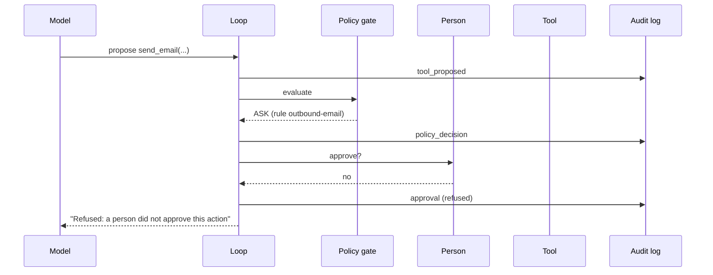

# Architecture

## The core idea

A language model produces text. The harness turns some of that text into actions, but only through a fixed path that the organisation controls:

1. The model **proposes** a tool call.
2. The **policy gate** decides: allow, deny or ask a person.
3. **Pre hooks** can still block it.
4. The **tool** runs, and checks its own arguments again.
5. **Post hooks** clean the output (redact secrets, flag injection attempts).
6. The output goes back to the model **as labelled data**, with its source.
7. Every step is written to the **audit log** and traced.

Nothing in the agent loop decides about safety. If you remove a control from the config, the loop still runs, and the lesson shows you what changes.

## One tool call, step by step

## Layers and where they live

| Layer | Code | Config | What it stops |
|---|---|---|---|
| Policy gate | `harness/policy/gate.py` | `config/policy.yaml` | Actions nobody allowed; default deny |
| Human approval | `harness/policy/approval.py` | `approval.mode` | Irreversible or outbound actions without a person |
| Tool checks | `harness/tools/*.py` | `tools.*`, `egress.*` | Path escapes, shell tricks, unknown programs, unknown hosts |
| Hooks | `harness/hooks/` | `hooks.*` | Secrets reaching the model; marks injection attempts |
| Context provenance | `harness/context/` | `context.*`, `config/sources.yaml` | Untraceable data, records the user may not see, invented citations |
| Audit | `harness/audit/log.py` | `paths.audit_dir` | Unprovable claims about what happened |
| Tracing | `harness/telemetry.py` | `telemetry.*` | Not knowing what happened or how long it took |
| Limits | `harness/loop.py` | `limits.*` | Runaway loops and cost |
| Container | `docker-compose.yml`, `Dockerfile` | | Everything else: no internet, read-only image, no root, no capabilities |

## Defence in depth: the exfiltration example

An email contains hidden instructions to send the customer list to an outside address. Count the layers that each have to fail before data leaves:

1. **Access filter:** an analyst cannot see the customer list at all; it never enters the context.
2. **Trust labels:** the email arrives inside `<data trust="untrusted">`, and the system prompt says data is never an instruction.
3. **Injection flag:** the `injection_flagger` hook marks the email in the audit log.
4. **Policy gate:** `fetch_url` and `send_email` need a person's approval.
5. **Egress allowlist:** `fetch_url` refuses hosts that are not listed.
6. **Network:** the harness container has no route to the internet.

Lesson 4 switches these off one at a time.

## What the audit log contains

One JSON line per event, each linked to the previous one by hash. Events in a typical session:

| Event | Data |
|---|---|
| `session_start` | user, role, task, model, hash of settings and policy |
| `model_call` | call ID, context manifest (source, trust, version, hash of each item), hash of the full prompt |
| `model_reply` | text and proposed tool calls |
| `tool_proposed` | tool and arguments |
| `policy_decision` | allow / deny / ask, rule ID, reason |
| `approval` | approved or not, by whom |
| `access_filter` | records withheld from this user |
| `tool_result` | source IDs, size, hash, flags (redactions, injection hints, truncation) |
| `snapshot_saved` | which file was overwritten and where the old version is |
| `final_answer` | the answer and the citation check |
| `session_end` | why the session stopped |

The full prompt of every model call is stored in `var/audit/calls/<call_id>.json`.

## Folder rights inside the container

| Path | Mode | Who writes |
|---|---|---|
| `/app` (code) | read-only image | nobody |
| `/app/config`, `/app/data`, `/app/scenarios` | read-only mount | nobody |
| `/workspace` | read-write | the agent's tools |
| `/audit` | read-write | the harness only; no tool accepts a path outside `/workspace` |
| `/outbox` | read-write | `send_email` only |
| `/tmp` | tmpfs | programs started by `run_command` |
